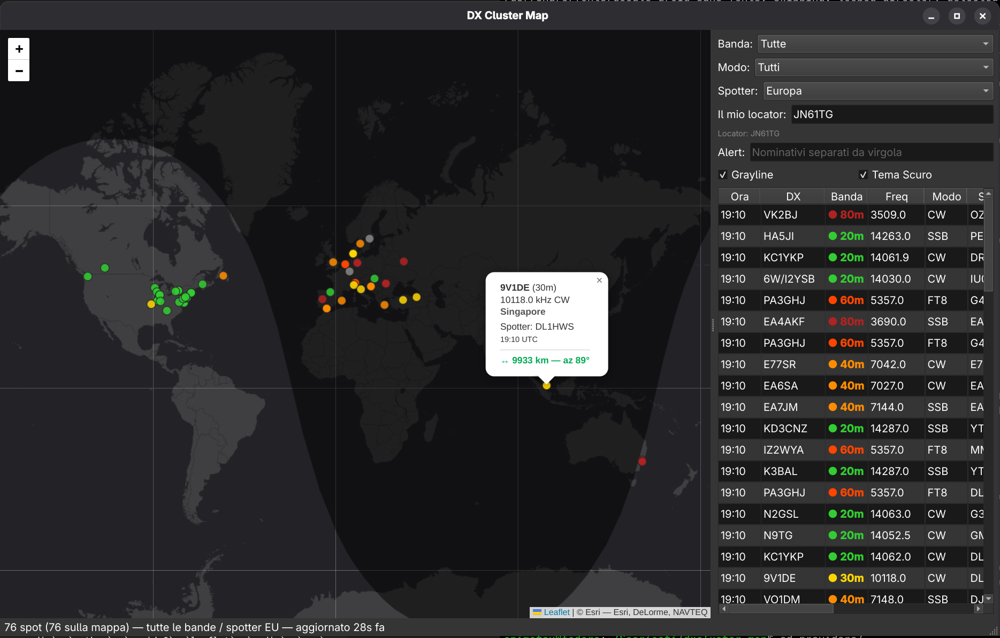

# 📻 DX Cluster Map


Un'applicazione desktop cross-platform (Linux/Windows) per visualizzare in tempo reale gli spot del DX Cluster su una mappa mondiale interattiva.



## ✨ Caratteristiche

- **Mappa Interattiva**: Visualizza gli spot su una mappa mondiale basata su Leaflet (OpenStreetMap / Esri).
- **Dati in tempo reale**: Integrazione con l'API di [Spothole](https://spothole.app) (aggregatore di DX Cluster, RBN, POTA, SOTA).
- **Filtri Intelligenti**: Filtra gli spot per Banda (160m–6m), Modo (CW, Fonia, Digitale) e Continente dello spotter.
- **Locator e Distanze**: Calcolo istantaneo della distanza (km) e dell'azimuth in base al tuo locator Maidenhead (es. JN45).
- **Grayline**: Visualizzazione del terminatore solare (giorno/notte) per capire al volo le finestre di propagazione.
- **Watchlist (Alert)**: Inserisci i nominativi che ti interessano. Se vengono spottati, riceverai una notifica di sistema (tray icon) e la riga sarà evidenziata.
- **Tema Chiaro/Scuro**: Interfaccia adattabile con un click, inclusa la mappa.
- **Layout Adattivo**: L'interfaccia si riorganizza automaticamente se trascinata su un monitor verticale (mappa in alto, lista in basso).
- **Persistenza**: Tutte le impostazioni (locator, filtri, alert, tema) vengono salvate e ripristinate al riavvio.

## 🚀 Installazione e Avvio

### Prerequisiti
- Python 3.10 o superiore
- Connessione a Internet (per il fetch degli spot e le tile della mappa)

### Avvio rapido (Linux)
Il progetto include uno script di avvio automatico che crea il virtualenv, installa le dipendenze e avvia l'applicazione.

```bash
git clone https://github.com/IZ0FIU/dxcluster-map.git
cd dxcluster-map
chmod +x run.sh
./run.sh
Nota per Windows: al momento l'app è testata su Linux. Su Windows è possibile avviarla manualmente creando un
ambiente virtuale e installando requirements.txt,
oppure usando python main.py dopo aver installato le dipendenze.

🛠️ Tecnologie utilizzate
Python: Linguaggio principale.

PySide6: Framework Qt per l'interfaccia grafica nativa.

QtWebEngine: Motore Chromium integrato per visualizzare la mappa.

Leaflet.js: Libreria JavaScript open-source per mappe interattive.

Spothole API: Fonte dei dati DX Cluster.

📡 Note sull'API
L'applicazione utilizza l'istanza pubblica e gratuita di Spothole. Se intendi usare l'app intensamente
o in modo continuativo, ti consiglio di ospitare una tua istanza di Spothole e
modificare l'URL nel file providers/spothole.py.

🤝 Contributi
I contributi sono benvenuti! Se trovi un bug o hai un'idea per una nuova funzionalità:

Apri una Issue.

Fai un Fork del progetto.

Crea un Pull Request.

📄 Licenza
Questo progetto è distribuito sotto licenza MIT. Vedi il file LICENSE per i dettagli.

☕ Ringraziamenti
A Spothole per l'ottimo servizio di aggregazione spot.

A OpenStreetMap per le tile della mappa.

A Joerg Dietrich per il plugin Leaflet Terminator (Grayline).
