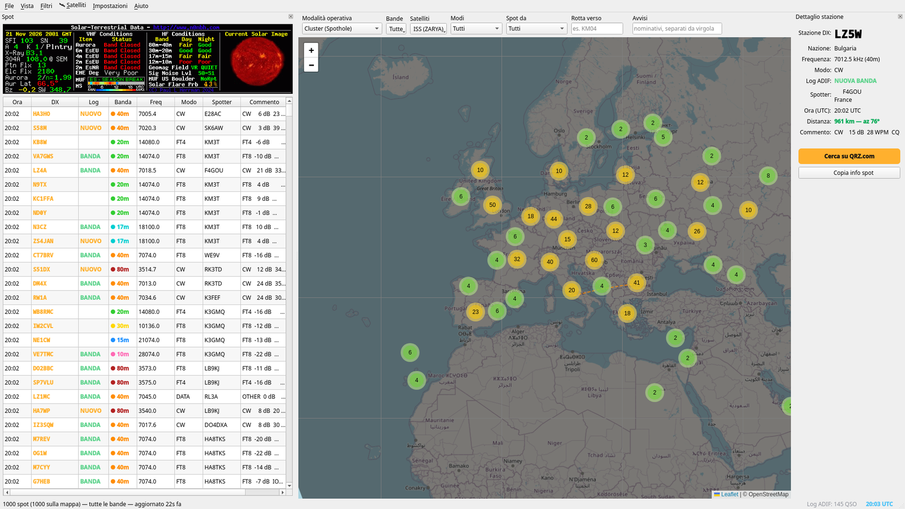
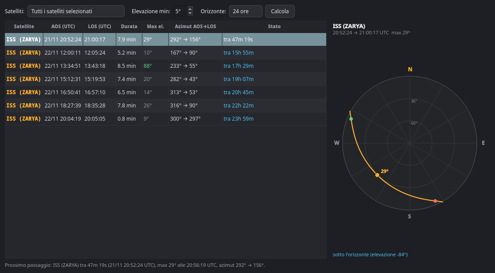

# DX Cluster Map

Mappa interattiva degli spot radioamatoriali per desktop: sorgenti multiple
(Spothole, WSJT-X e PSK Reporter), satelliti in tempo reale, previsione dei
passaggi, worked-before dal log ADIF e avvisi sonori/vocali.

[](https://github.com/IZ0FIU/dxcluster-map/releases/latest)
[](#download)
[](#licenza)



## Download

Dalla pagina [Releases](https://github.com/IZ0FIU/dxcluster-map/releases/latest):

| Piattaforma | File | Avvio |
|---|---|---|
| **Windows 10/11 (64 bit)** | `DXClusterMap-vX.Y.Z-windows-setup.exe` | esegui l'installer: installazione per utente, senza permessi di amministratore |
| **Windows (portable)** | `DXClusterMap-vX.Y.Z-windows-x64.zip` | scompatta e avvia `DXClusterMap.exe` |
| **Linux (AppImage)** | `DXClusterMap-vX.Y.Z-x86_64.AppImage` | rendi eseguibile e avvia: nessuna installazione |
| **Linux (sorgenti)** | `DXClusterMap-vX.Y.Z-linux.tar.gz` | scompatta, crea il venv, `pip install -r requirements.txt`, poi `./run.sh` |

Su Windows non serve installare Python: l'eseguibile contiene già Python e
Qt/PySide6. L'installer crea i collegamenti nel menu Start e, se vuoi, sul
desktop; la versione portable non scrive nulla nel sistema. I dati utente
(impostazioni e log) restano in `%LOCALAPPDATA%\DXClusterMap`.

Al primo avvio Windows SmartScreen potrebbe chiedere conferma perché
l'eseguibile non è firmato: scegli **Ulteriori informazioni → Esegui comunque**.

### Linux

L'**AppImage** contiene già Python e Qt: è un singolo file, non serve
installare nulla.

```bash
chmod +x DXClusterMap-vX.Y.Z-x86_64.AppImage
./DXClusterMap-vX.Y.Z-x86_64.AppImage
```

Per integrare l'icona nel menu applicazioni puoi usare
[AppImageLauncher](https://github.com/TheAssassin/AppImageLauncher) o spostare
il file in `~/Applications`.

Se l'AppImage non parte perché manca FUSE 2 (su alcune distribuzioni recenti
non è installato per default), avviala così:

```bash
./DXClusterMap-vX.Y.Z-x86_64.AppImage --appimage-extract-and-run
```

In alternativa, dai **sorgenti** (serve Python 3.10 o superiore con
`python3-venv` e una connessione a Internet per le mappe e i dati TLE):

```bash
tar xzf DXClusterMap-vX.Y.Z-linux.tar.gz
cd DXClusterMap-vX.Y.Z
python3 -m venv .venv
.venv/bin/pip install -r requirements.txt
./run.sh
```

## Funzioni principali

- **Sorgenti dati** — Spothole (cluster web), WSJT-X via UDP locale (porta
  2237) e PSK Reporter (polling ogni 10 minuti con backoff)
- **Ponte UDP** — inoltro byte-per-byte dei datagrammi WSJT-X ad altri
  programmi (es. WavelogGate) su una porta separata, per default
  `127.0.0.1:2238`
- **Satelliti** — circa 100 satelliti radioamatoriali con posizione in tempo
  reale, etichetta e traiettoria orbitale (clic sul marker); cache TLE su disco
  per 24 ore
- **Passaggi satelliti** (`F10`) — previsione AOS/LOS, elevazione massima,
  azimut e **polar plot** del passaggio, calcolata con SGP4
- **Worked-before da log ADIF** — legge `wsjtx_log.adi`, marca **B4** gli spot
  già a log e segnala **NUOVO** (nuova entità DXCC) e **BANDA** (nuova banda);
  ricarica automatica quando WSJT-X aggiorna il log
- **Avvisi sonori e vocali** — suoni distinti per alert, nuovo DXCC e
  "ti sta chiamando" (decodifiche WSJT-X col proprio nominativo), con sintesi
  vocale e notifica di sistema
- **Filtri** — bande, modo, continente dello spotter, età degli spot, satellite,
  nominativi in alert e rotta verso un locator target
- **Mappa** — grayline, heatmap, legenda bande, distanza e bearing dal proprio
  locator, rotta a grande cerchio verso il target
- **Interfaccia** — tema scuro/chiaro, dock spostabili, orologio UTC nella
  barra di stato, icona nel system tray

## Passaggi satelliti

Apri la finestra da **Satelliti → Passaggi e polar plot…** oppure con `F10`.



- Tabella con **AOS, LOS, durata, elevazione massima, azimut** e conto alla
  rovescia, con orari in UTC
- **Polar plot** con nord in alto, cerchi a 30/60/90°, traiettoria del
  passaggio, punti di AOS/LOS e di massima elevazione
- Posizione attuale del satellite: se è sotto l'orizzonte il plot lo indica
  invece di disegnare un punto fuorviante
- Filtri per satellite, elevazione minima e orizzonte (6/12/24/48 ore)
- Richiede il **locator** impostato in *Impostazioni → Locator*

## Worked-before dal log ADIF

Il percorso di `wsjtx_log.adi` viene rilevato automaticamente; puoi indicarne
uno diverso in *Impostazioni → File ADIF* (con pulsante **Sfoglia…**).

| Badge | Significato |
|---|---|
| **B4** | Nominativo già a log su quella banda (riga attenuata) |
| **NUOVO** | Nuova entità DXCC, mai lavorata |
| **BANDA** | Entità già lavorata, ma non su quella banda |

Il file viene ricaricato automaticamente quando cambia; puoi forzare la
rilettura con `F9`. Lo stato è visibile anche nel **Dettaglio stazione** e
nelle statistiche del log.

## Avvisi sonori e vocali

In *Impostazioni → Audio* puoi attivare suono e voce, regolare il volume e
usare **Prova**. I toggle rapidi sono anche nel menu **Filtri**.

- Suoni distinti per alert generico, **nuovo DXCC** e **"ti sta chiamando"**
- La voce usa `QtTextToSpeech` (motore `speechd`); se non disponibile,
  ripiega su `spd-say` o `espeak-ng`
- "Ti sta chiamando" riconosce le decodifiche WSJT-X indirizzate al tuo
  nominativo (es. `W1ABC IZ0FIU -10`) e mostra anche una notifica di sistema
- Il campo **Nominativo** in *Impostazioni* è usato per questo controllo; se
  vuoto viene usato il nominativo di PSK Reporter

## Scorciatoie da tastiera

| Tasto | Azione |
|---|---|
| `F5` | Aggiorna gli spot |
| `F9` | Ricarica il log ADIF |
| `F10` | Passaggi satelliti e polar plot |
| `F11` | Mappa a tutto schermo |
| `Esc` | Torna alla lista / esci da tutto schermo |
| `Ctrl+F` | Vai al campo Avvisi |

## Primo avvio

1. Imposta il **locator** della tua stazione in *Impostazioni → Locator*
2. Indica il tuo **nominativo** in *Impostazioni → Nominativo* (per gli avvisi
   "ti sta chiamando")
3. Controlla il percorso del **file ADIF** in *Impostazioni → File ADIF*
4. Scegli la **Modalità operativa** nella barra dei filtri: Cluster, WSJT-X o
   PSK Reporter

## Sviluppo

Il progetto è in Python con PySide6; la mappa usa Leaflet. Per eseguire dal
sorgente, eseguire i test e pubblicare una release vedi
[CONTRIBUTING.md](CONTRIBUTING.md).

## Licenza

MIT — vedi [LICENSE](LICENSE). Il software è fornito così com'è, senza
garanzie; puoi usarlo, modificarlo e ridistribuirlo mantenendo l'avviso di
copyright.
